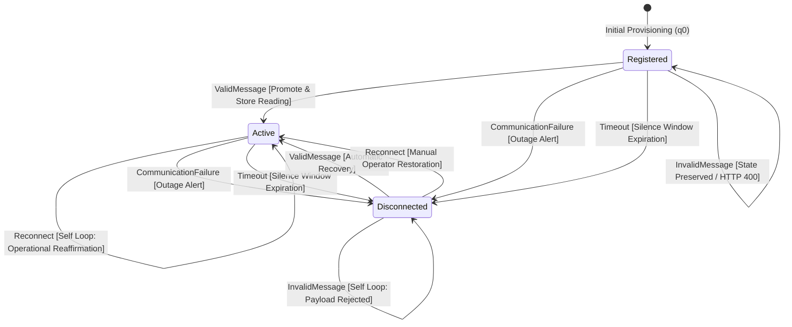

# Formal Languages and Automata Theory (FLAT) Individual Project Report
## Finite State Machine Modeling for IoT Device Status Monitoring System

**Course:** IT2303 – Formal Languages and Automata Theory (FLAT)  
**Institution:** Velalar College of Engineering and Technology (Autonomous), Erode – 638 012  
**Department:** Department of Information Technology  
**Student Name:** DHANUSHEYA P  
**Register Number:** 24ITR018  
**Class:** B.Tech. Information Technology (Third Year / 2026 Batch)  
**Academic Year:** 2025–2026  
**Project GitHub Repository:** [https://github.com/Dhanusheyap755/IoT-Device-Status-Monitoring-System](https://github.com/Dhanusheyap755/IoT-Device-Status-Monitoring-System)  
**Live Deployed Application:** [https://dhanusheyap755.github.io/IoT-Device-Status-Monitoring-System/](https://dhanusheyap755.github.io/IoT-Device-Status-Monitoring-System/)  

---

## 1. Mathematical Formalism of the Automaton

In Formal Languages and Automata Theory, a **Deterministic Finite Automaton (DFA)** is formally expressed as a 5-tuple:

$$M = (Q, \Sigma, \delta, q_0, F)$$

Where:
- $Q$ is a non-empty, finite set of states.
- $\Sigma$ is a finite set of input symbols (the alphabet).
- $\delta : Q \times \Sigma \to Q$ is the state transition function.
- $q_0 \in Q$ is the designated start (initial) state.
- $F \subseteq Q$ is the set of final (or operational accepting) states.

### 1.1 State Set ($Q$)
The automaton models three distinct operational conditions of an IoT sensor node:

$$Q = \{\text{Registered}, \text{Active}, \text{Disconnected}\}$$

1. **`Registered` ($q_0$ - Start State):**
   - The device is provisioned in the database with identity metadata (`deviceId`, `name`, `type`, `location`).
   - No valid telemetry packet has been ingested yet.
   - The node is awaiting its initial transmission.

2. **`Active` ($F$ - Operational Accepting State):**
   - The device is certified online and communicating authentically.
   - Incoming telemetry packets satisfy all schema and physical boundary checks.
   - Telemetry data is recorded in the time-series repository, and keepalive timestamps are updated.

3. **`Disconnected` (Fault / Outage State):**
   - The device has experienced a network failure, packet drop, or keepalive timeout ($>45\text{ seconds}$).
   - Telemetry ingestion has halted; the device is isolated until communication is re-established.

### 1.2 Input Alphabet ($\Sigma$)
The input alphabet consists of five discrete events representing physical, network, and operator stimuli:

$$\Sigma = \{\text{ValidMessage}, \text{InvalidMessage}, \text{CommunicationFailure}, \text{Timeout}, \text{Reconnect}\}$$

1. **`ValidMessage`:** An incoming HTTP POST message containing well-formed, in-bounds sensor telemetry ($-40^\circ\text{C} \le \text{Temperature} \le 85^\circ\text{C}$, $0\% \le \text{Humidity} \le 100\%$, $0\% \le \text{Battery} \le 100\%$).
2. **`InvalidMessage`:** A corrupted, malformed, or out-of-range transmission (e.g. Temperature $= 200^\circ\text{C}$, missing fields, non-numeric values).
3. **`CommunicationFailure`:** A network socket drop, packet loss, or simulated physical link severance.
4. **`Timeout`:** An expired silence threshold where no telemetry packet was received within the maximum allowable keepalive window (45 seconds).
5. **`Reconnect`:** An explicit operator command or gateway re-handshake restoring network synchronization.

---

## 2. State Transition Diagram

The Deterministic Finite Automaton is represented by the directed state graph below.

### 2.1 State Graph (Visual Topology)

```
              ┌─────────────────────────────────────────────────────────┐
              │                   ValidMessage / Reconnect              │
              │             ┌─────────────────────────────────┐         │
              ▼             │                                 │         │
      ┌───────────────┐     │      ValidMessage (Self-Loop)   │         │
      │               │     │           ┌──────────┐          │         │
───>  │  Registered   │─────┼──────────>│  Active  │<─────────┘         │
      │     (q0)      │     │           │   (F)    │                    │
      └───────┬───────┘     │           └────┬─────┘                    │
              │             │                │                          │
              │             │  CommFailure / │                          │
              │             │  Timeout       │                          │
              │ CommFailure │                ▼                          │
              │ / Timeout   │       ┌─────────────────┐                 │
              │             │       │                 │                 │
              └─────────────┼──────>│  Disconnected   │─────────────────┘
                            │       │                 │
                            │       └────────┬────────┘
                            │                │
                            └────────────────┘
                             (ValidMessage / Reconnect)

  [ Self-Loops (State Preserved / Invariant Guaranteed): ]
  • Registered   + InvalidMessage       ──> Registered   (Alert: Warning)
  • Active       + InvalidMessage       ──> Active       (Alert: Warning)
  • Active       + ValidMessage         ──> Active       (Telemetry Updated)
  • Disconnected + InvalidMessage       ──> Disconnected (Alert: Warning)
  • Disconnected + CommunicationFailure ──> Disconnected (Alert: Error)
  • Disconnected + Timeout              ──> Disconnected (Alert: Warning)
```

### 2.2 Formal State Diagram Specification (Mermaid v2)


---

## 3. State Transition Table ($\delta: Q \times \Sigma \to Q$)

The transition function $\delta$ maps every state-input pair $(q, \sigma) \in Q \times \Sigma$ deterministically to a unique destination state $q' \in Q$.

| Current State ($q$) | Input Symbol ($\sigma$) | Next State ($\delta(q, \sigma)$) | System Action & Database Side Effect | Alert Generated? |
| :--- | :--- | :--- | :--- | :--- |
| **Registered** | `ValidMessage` | **Active** | Promote node to operational state; persist telemetry in MongoDB; update `lastSeen`. | No |
| **Registered** | `InvalidMessage` | **Registered** | Reject payload with HTTP 400; discard reading; preserve current state; log validation alert. | Yes (Warning) |
| **Registered** | `CommunicationFailure` | **Disconnected** | Demote node to Disconnected; log communication error alert in database. | Yes (Error) |
| **Registered** | `Timeout` | **Disconnected** | Demote node due to silence window expiration; log timeout alert. | Yes (Warning) |
| **Registered** | `Reconnect` | **Active** | Explicit operator activation; transition to Active; log info alert. | Yes (Info) |
| **Active** | `ValidMessage` | **Active** | Self-loop: maintain Active state; store new sensor reading; refresh `lastSeen`. | No |
| **Active** | `InvalidMessage` | **Active** | Self-loop: reject payload with HTTP 400; discard reading; raise validation alert. | Yes (Warning) |
| **Active** | `CommunicationFailure` | **Disconnected** | Demote node from Active to Disconnected; raise high-priority network failure alert. | Yes (Error) |
| **Active** | `Timeout` | **Disconnected** | Demote node from Active to Disconnected; raise heartbeat silence alert. | Yes (Warning) |
| **Active** | `Reconnect` | **Active** | Self-loop: reaffirm operational status; maintain Active state; log info alert. | Yes (Info) |
| **Disconnected** | `ValidMessage` | **Active** | Automatic recovery: promote device to Active; persist valid telemetry; raise recovery alert. | Yes (Info) |
| **Disconnected** | `Reconnect` | **Active** | Manual operator restoration: transition to Active state; log reconnection alert. | Yes (Info) |
| **Disconnected** | `CommunicationFailure` | **Disconnected** | Self-loop: maintain Disconnected state; record recurrent network outage alert. | Yes (Error) |
| **Disconnected** | `Timeout` | **Disconnected** | Self-loop: maintain Disconnected state; record recurrent timeout alert. | Yes (Warning) |
| **Disconnected** | `InvalidMessage` | **Disconnected** | Self-loop: maintain Disconnected state; reject payload with HTTP 400; raise validation alert. | Yes (Warning) |

### 3.1 Mathematical Invariants & Theoretical Properties
1. **Determinism:**
   $$\forall (q, \sigma) \in Q \times \Sigma, \quad |\delta(q, \sigma)| = 1$$
   Every state has exactly one unambiguous destination for each input symbol. No $\epsilon$-transitions or nondeterministic branches exist.
2. **Completeness:**
   $$|Q \times \Sigma| = |Q| \times |\Sigma| = 3 \times 5 = 15$$
   The transition function is total and comprehensively defined over all 15 permutations.
3. **Safety Invariant (Invalid Message Containment):**
   $$\forall q \in Q, \quad \delta(q, \text{InvalidMessage}) = q$$
   An invalid message can never alter the current state of a device or compromise system integrity.
4. **Liveness & Recovery Invariant:**
   $$\delta(\text{Disconnected}, \text{ValidMessage}) = \text{Active} \quad \land \quad \delta(\text{Disconnected}, \text{Reconnect}) = \text{Active}$$
   A disconnected device is guaranteed to return to the operational accepting state upon receiving a valid telemetry transmission or an explicit reconnection command.

---

## 4. FSM Source Code Implementation

### 4.1 Core Automata Engine (`backend/fsm/deviceStateMachine.js`)

```javascript
/**
 * DETERMINISTIC FINITE STATE MACHINE (DFA) ENGINE
 * Formal Automata Model: M = (Q, Sigma, delta, q0, F)
 * 
 * Q     = { Registered, Active, Disconnected }
 * Sigma = { ValidMessage, InvalidMessage, CommunicationFailure, Timeout, Reconnect }
 * q0    = Registered
 * F     = { Active }
 */

const Device = require('../models/Device');
const DeviceEvent = require('../models/DeviceEvent');
const Alert = require('../models/Alert');

const STATES = {
  REGISTERED: 'Registered',
  ACTIVE: 'Active',
  DISCONNECTED: 'Disconnected'
};

const EVENTS = {
  VALID_MESSAGE: 'ValidMessage',
  INVALID_MESSAGE: 'InvalidMessage',
  COMMUNICATION_FAILURE: 'CommunicationFailure',
  TIMEOUT: 'Timeout',
  RECONNECT: 'Reconnect'
};

// Complete Transition Table delta: Q x Sigma -> Q
const TRANSITION_TABLE = {
  [STATES.REGISTERED]: {
    [EVENTS.VALID_MESSAGE]: {
      nextState: STATES.ACTIVE,
      generateAlert: false,
      reason: 'First valid telemetry received - device operational'
    },
    [EVENTS.INVALID_MESSAGE]: {
      nextState: STATES.REGISTERED, // State unchanged (Academic Rule)
      generateAlert: true,
      alertType: 'INVALID_MESSAGE',
      severity: 'Warning',
      reason: 'Invalid message received - state unchanged'
    },
    [EVENTS.COMMUNICATION_FAILURE]: {
      nextState: STATES.DISCONNECTED,
      generateAlert: true,
      alertType: 'COMMUNICATION_FAILURE',
      severity: 'Error',
      reason: 'Communication failure during registration phase'
    },
    [EVENTS.TIMEOUT]: {
      nextState: STATES.DISCONNECTED,
      generateAlert: true,
      alertType: 'TIMEOUT',
      severity: 'Warning',
      reason: 'Registration timed out without valid data'
    },
    [EVENTS.RECONNECT]: {
      nextState: STATES.ACTIVE,
      generateAlert: true,
      alertType: 'RECONNECTION',
      severity: 'Info',
      reason: 'Device reconnected manually'
    }
  },
  [STATES.ACTIVE]: {
    [EVENTS.VALID_MESSAGE]: {
      nextState: STATES.ACTIVE, // Self loop
      generateAlert: false,
      reason: 'Continuous valid telemetry stream'
    },
    [EVENTS.INVALID_MESSAGE]: {
      nextState: STATES.ACTIVE, // State unchanged (Academic Rule)
      generateAlert: true,
      alertType: 'INVALID_MESSAGE',
      severity: 'Warning',
      reason: 'Invalid message received while active - state preserved'
    },
    [EVENTS.COMMUNICATION_FAILURE]: {
      nextState: STATES.DISCONNECTED,
      generateAlert: true,
      alertType: 'COMMUNICATION_FAILURE',
      severity: 'Error',
      reason: 'Network link lost or device unreachable'
    },
    [EVENTS.TIMEOUT]: {
      nextState: STATES.DISCONNECTED,
      generateAlert: true,
      alertType: 'TIMEOUT',
      severity: 'Warning',
      reason: 'Heartbeat timeout - no message for > 45s'
    },
    [EVENTS.RECONNECT]: {
      nextState: STATES.ACTIVE, // Self loop
      generateAlert: true,
      alertType: 'RECONNECTION',
      severity: 'Info',
      reason: 'Active device ping/reconnect acknowledged'
    }
  },
  [STATES.DISCONNECTED]: {
    [EVENTS.VALID_MESSAGE]: {
      nextState: STATES.ACTIVE,
      generateAlert: true,
      alertType: 'RECONNECTION',
      severity: 'Info',
      reason: 'Valid telemetry restored - device recovered to Active'
    },
    [EVENTS.INVALID_MESSAGE]: {
      nextState: STATES.DISCONNECTED, // State unchanged
      generateAlert: true,
      alertType: 'INVALID_MESSAGE',
      severity: 'Warning',
      reason: 'Invalid message received while disconnected'
    },
    [EVENTS.COMMUNICATION_FAILURE]: {
      nextState: STATES.DISCONNECTED, // Self loop
      generateAlert: true,
      alertType: 'COMMUNICATION_FAILURE',
      severity: 'Error',
      reason: 'Repeated communication failure'
    },
    [EVENTS.TIMEOUT]: {
      nextState: STATES.DISCONNECTED, // Self loop
      generateAlert: true,
      alertType: 'TIMEOUT',
      severity: 'Warning',
      reason: 'Device continues in timed-out state'
    },
    [EVENTS.RECONNECT]: {
      nextState: STATES.ACTIVE,
      generateAlert: true,
      alertType: 'RECONNECTION',
      severity: 'Info',
      reason: 'Operator triggered reconnect - state restored to Active'
    }
  }
};

/**
 * Pure Automata Evaluation Function delta(q, sigma)
 */
function evaluateTransition(currentState, event) {
  const stateTransitions = TRANSITION_TABLE[currentState];
  if (!stateTransitions) {
    throw new Error(`Unknown state: "${currentState}"`);
  }
  const transition = stateTransitions[event];
  if (!transition) {
    throw new Error(`Unknown event: "${event}" for state: "${currentState}"`);
  }
  return {
    fromState: currentState,
    toState: transition.nextState,
    stateChanged: currentState !== transition.nextState,
    generateAlert: transition.generateAlert,
    alertType: transition.alertType || null,
    severity: transition.severity || 'Info',
    reason: transition.reason
  };
}

/**
 * Executes state transition with atomic MongoDB persistence
 */
async function transitionDevice(deviceId, event, metadata = {}) {
  const device = await Device.findOne({ deviceId });
  if (!device) {
    throw new Error(`Device "${deviceId}" not found`);
  }

  const previousState = device.status;
  const evaluation = evaluateTransition(previousState, event);
  const nextState = evaluation.toState;

  // Update device state in MongoDB
  device.status = nextState;
  device.lastSeen = new Date();
  await device.save();

  // Record audit event in deviceevents collection
  const deviceEvent = new DeviceEvent({
    deviceId,
    eventType: event,
    fromState: previousState,
    toState: nextState,
    reason: metadata.reason || evaluation.reason,
    metadata
  });
  await deviceEvent.save();

  // Emit alert if transition mandates
  let alert = null;
  if (evaluation.generateAlert) {
    alert = new Alert({
      deviceId,
      alertType: evaluation.alertType,
      severity: evaluation.severity,
      message: metadata.message || evaluation.reason,
      details: { ...metadata, previousState, nextState }
    });
    await alert.save();
  }

  return {
    deviceId,
    previousState,
    currentState: nextState,
    stateChanged: evaluation.stateChanged,
    alert
  };
}

module.exports = {
  STATES,
  EVENTS,
  TRANSITION_TABLE,
  evaluateTransition,
  transitionDevice
};
```

---

### 4.2 Telemetry Boundary & Alphabet Classification (`backend/middleware/validateMessage.js`)

```javascript
/**
 * INGESTION VALIDATOR & ALPHABET CLASSIFIER
 * Classifies HTTP payload into ValidMessage or InvalidMessage
 */

const { transitionDevice, EVENTS } = require('../fsm/deviceStateMachine');
const Device = require('../models/Device');

async function validateMessage(req, res, next) {
  const { deviceId, temperature, humidity, battery } = req.body;

  // Check mandatory deviceId
  if (!deviceId || typeof deviceId !== 'string') {
    return res.status(400).json({
      error: 'Invalid deviceId: must be a non-empty string',
      inputSymbol: EVENTS.INVALID_MESSAGE
    });
  }

  const device = await Device.findOne({ deviceId });
  if (!device) {
    return res.status(404).json({ error: `Device "${deviceId}" not found` });
  }

  const errors = [];

  // Temperature physical validation: -40 C to 85 C
  if (temperature === undefined || typeof temperature !== 'number' || isNaN(temperature)) {
    errors.push('temperature is required and must be a number');
  } else if (temperature < -40 || temperature > 85) {
    errors.push(`temperature ${temperature}C out of bounds (-40C to 85C)`);
  }

  // Humidity physical validation: 0% to 100%
  if (humidity === undefined || typeof humidity !== 'number' || isNaN(humidity)) {
    errors.push('humidity is required and must be a number');
  } else if (humidity < 0 || humidity > 100) {
    errors.push(`humidity ${humidity}% out of bounds (0% to 100%)`);
  }

  // Battery percentage validation: 0% to 100%
  if (battery !== undefined && (typeof battery !== 'number' || battery < 0 || battery > 100)) {
    errors.push(`battery ${battery}% out of bounds (0% to 100%)`);
  }

  // If validation fails -> Classify as InvalidMessage
  if (errors.length > 0) {
    // Academic Rule: state unchanged, log alert, return HTTP 400
    const transitionResult = await transitionDevice(deviceId, EVENTS.INVALID_MESSAGE, {
      errors,
      rejectedPayload: req.body,
      reason: `Validation failed: ${errors.join('; ')}`
    });

    return res.status(400).json({
      error: 'Validation failed - message rejected',
      errors,
      fsm: {
        currentState: transitionResult.currentState,
        stateChanged: false,
        inputSymbol: EVENTS.INVALID_MESSAGE
      }
    });
  }

  // Validation successful -> Proceed as ValidMessage
  req.inputSymbol = EVENTS.VALID_MESSAGE;
  req.device = device;
  next();
}

module.exports = validateMessage;
```

---

## 5. Step-by-Step Procedure & Algorithm

The complete operational procedure of the Finite State Machine follows these 10 distinct algorithmic steps:

```
[Start]
   │
   ▼
1. Device Provisioning (Initial State q0 = Registered saved in MongoDB)
   │
   ▼
2. HTTP POST Telemetry Ingestion (/api/readings)
   │
   ▼
3. Boundary & Type Validation (Check deviceId, Temp: -40..85°C, Hum: 0..100%, Bat: 0..100%)
   │
   ├── [Failed] ──> Classify: InvalidMessage
   │                  │
   │                  ├── Evaluate: delta(q, InvalidMessage) = q (State Unchanged)
   │                  ├── Generate: Warning Alert in MongoDB
   │                  └── Return: HTTP 400 Bad Request to Client [Stop]
   │
   └── [Passed] ──> Classify: ValidMessage
                      │
                      ├── Evaluate: delta(q, ValidMessage) = Active
                      ├── Update: device.status = Active, lastSeen = now()
                      ├── Record: Telemetry document in sensorreadings collection
                      ├── Record: State transition audit event in deviceevents collection
                      └── Return: HTTP 200 OK with Active state [Stop]
```

### Detailed Execution Steps:

1. **Step 1: Device Provisioning & Start State Initialization:**  
   When a new sensor node is registered via `POST /api/devices`, the backend creates a document in MongoDB with default status `status: 'Registered'`. This satisfies $q_0 = \text{Registered}$.

2. **Step 2: Incoming Telemetry Packet Reception:**  
   The client workstation or simulated IoT node dispatches an HTTP POST request to `/api/readings` with JSON:  
   `{"deviceId": "IOT001", "temperature": 28.5, "humidity": 65, "battery": 92}`.

3. **Step 3: Deterministic Input Alphabet Classification:**  
   The `validateMessage` middleware inspects the payload. If all numeric bounds and mandatory fields are valid, the symbol is classified as `\sigma = ValidMessage`. If any bound is violated (e.g. Temperature $= 200^\circ\text{C}$), the symbol is classified as `\sigma = InvalidMessage`.

4. **Step 4: Transition Function Evaluation:**  
   The FSM engine invokes `evaluateTransition(currentState, event)`. It looks up `TRANSITION_TABLE[currentState][event]` in $O(1)$ time and determines the deterministic destination state $q'$.

5. **Step 5: Enforcing the Invalid Message Invariant:**  
   When `InvalidMessage` occurs, the rule $\delta(q, \text{InvalidMessage}) = q$ guarantees that the device's current state is never modified. An alert of type `INVALID_MESSAGE` is persisted in the `alerts` collection, and an HTTP `400 Bad Request` response is immediately returned.

6. **Step 6: Promotion to Operational State:**  
   When `ValidMessage` is received from `Registered` or `Disconnected`, the state machine updates the device status to `Active` ($F$). The sensor reading is written to the `sensorreadings` collection.

7. **Step 7: Fault Detection (Communication Failure & Timeout):**  
   When a network outage simulation or a heartbeat timeout ($>45\text{s}$) is triggered, the event `CommunicationFailure` or `Timeout` is dispatched. The state machine transitions the node to `Disconnected` and records an error alert.

8. **Step 8: Recovery & Reconnection:**  
   When a disconnected device sends a new valid message or receives a manual operator reconnect command, $\delta(\text{Disconnected}, \text{ValidMessage}) = \text{Active}$ restores the device to operational status.

9. **Step 9: Non-Repudiable State Transition Auditing:**  
   Every state transition is atomically logged in the `deviceevents` collection in MongoDB Atlas with `fromState`, `toState`, `eventType`, `reason`, and a UTC `timestamp`.

10. **Step 10: Real-time UI Visualization:**  
    The React frontend polls `/api/devices` and visualizes the automaton on the **FSM Visualizer Page**, highlighting the active state with a glowing blue/green ring and listing chronological transitions in an audit ledger.

---

## 6. Experimental Test Cases & Verification Results

| Test ID | Initial State ($q$) | Input Symbol ($\sigma$) | Expected Next State ($\delta$) | Actual Result | Status |
| :--- | :--- | :--- | :--- | :--- | :--- |
| **TC-01** | `Registered` | `ValidMessage` (Temp: 25°C) | `Active` | Device status updated to `Active`; reading saved | **PASS** |
| **TC-02** | `Registered` | `InvalidMessage` (Temp: 200°C) | `Registered` | Status remains `Registered`; HTTP 400 returned; alert logged | **PASS** |
| **TC-03** | `Active` | `ValidMessage` (Temp: 30°C) | `Active` | Self-loop: status remains `Active`; reading appended | **PASS** |
| **TC-04** | `Active` | `InvalidMessage` (Hum: 150%) | `Active` | Self-loop: status remains `Active`; HTTP 400; alert logged | **PASS** |
| **TC-05** | `Active` | `CommunicationFailure` | `Disconnected` | Device status transitions to `Disconnected`; error alert logged | **PASS** |
| **TC-06** | `Active` | `Timeout` (>45s silence) | `Disconnected` | Device status transitions to `Disconnected`; warning alert logged | **PASS** |
| **TC-07** | `Disconnected` | `ValidMessage` (Temp: 22°C) | `Active` | Automatic recovery: status transitions to `Active` | **PASS** |
| **TC-08** | `Disconnected` | `Reconnect` | `Active` | Manual restoration: status transitions to `Active` | **PASS** |

---

*Report prepared and submitted for Formal Languages and Automata Theory (FLAT) by DHANUSHEYA P (24ITR018), Department of Information Technology, Velalar College of Engineering and Technology.*
